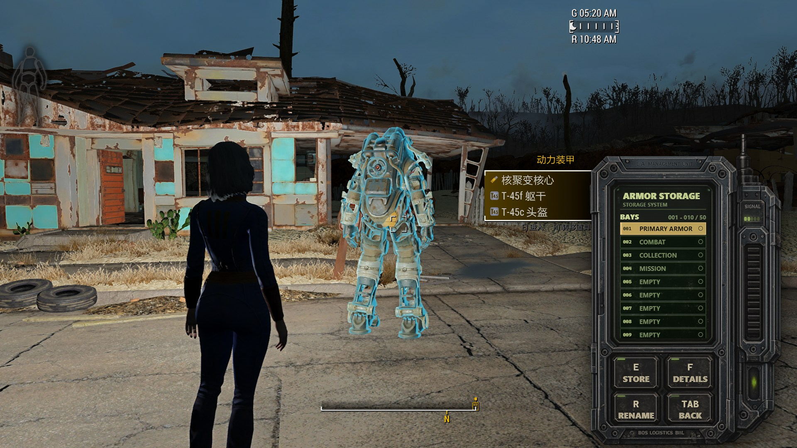
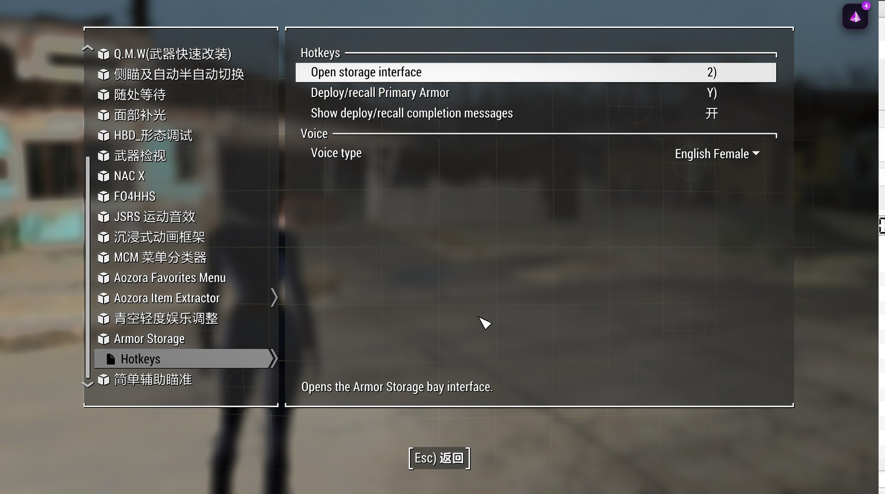

# Power Armor Manager

> Fallout 4 的小型动力甲仓库终端，基于 PrismaUI 2 与 GOE，支持键盘、手柄和滚轮操作。  
> A compact Fallout 4 power armor storage terminal powered by PrismaUI 2 and GOE, with keyboard, gamepad, and wheel navigation.

[](releases/v2.2.7/RELEASE_NOTES.md)
[](releases/v2.2.7/)
[](https://fallout.bethesda.net/)
[](https://www.nexusmods.com/fallout4/mods/74160)
[](#功能)
[](LICENSE.md)

<p align="center">
  <b>[STORAGE] Power Armor Storage</b>&nbsp;&nbsp;·&nbsp;&nbsp;
  <b>[SLOTS] 50 Bays</b>&nbsp;&nbsp;·&nbsp;&nbsp;
  <b>[GOE] GOE Variant</b>&nbsp;&nbsp;·&nbsp;&nbsp;
  <b>[INPUT] Keyboard / Gamepad / Wheel</b>
</p>

## 中文

Power Armor Manager 为 Fallout 4 提供一个小型、设备感的动力甲仓库终端。项目包含 F4SE 原生插件、PrismaUI 界面、MCM 配置、Papyrus 接口和中英文发布包。

### 功能

| 标记 | 功能 |
|---|---|
| `[STORAGE]` | 将动力甲存入隐藏仓库，并在需要时部署回玩家附近 |
| `[SLOTS]` | 50 个仓位，每页显示 10 个 |
| `[PRIMARY]` | 01 号仓位固定为主动力甲，支持独立快捷召唤/收回 |
| `[DETAILS]` | 查看头盔、胸甲、四肢等动力甲部件信息 |
| `[RENAME]` | 为普通仓位设置用途名称，01 号主动力甲不可改名 |
| `[INPUT]` | 键盘、手柄和滚轮导航；不启用鼠标焦点/点击作为支持操作 |
| `[LANG]` | 中文和英文独立发布包，英文版保留独立布局调整 |

### 前置要求

- Fallout 4。
- 与游戏版本匹配的 F4SE。
- Address Library for F4SE Plugins。
- Mod Configuration Menu (MCM)。
- PrismaUI Framework 2.0.2 或兼容的后续 2.x 版本。
- Garden of Eden Papyrus Script Extender (GOE)。

### 仓库结构

```text
Source/                         源码、UI 资源和构建脚本
releases/v2.2.7/                中文和英文最终安装包
docs/                           设计、发布说明和预览图
```

### 构建

native 源码不绑定原开发者本机路径。先设置 CommonLibF4 路径：

```powershell
$env:COMMONLIBF4_XMAKE_ROOT = 'D:\path\to\commonlibf4-frakkin64'
cd Source/native/PowerArmorMgrPlugin
build_dll.bat
```

Papyrus 源码位于 `Source/mod/CHS/Scripts/Source/User` 和 `Source/mod/EN/Scripts/Source/User`。编译后的 PEX、ESP 和 DLL 只作为最终发布包中的运行时产物提供。

### 预览





### 最终版本

- [Power Armor Manager 2.2.7 CHS](releases/v2.2.7/PowerArmorManager_2.2.7_CHS.zip)
- [Power Armor Manager 2.2.7 EN](releases/v2.2.7/PowerArmorManager_2.2.7_EN.zip)
- [2.2.7 Release Notes](releases/v2.2.7/RELEASE_NOTES.md)

## English

Power Armor Manager is a compact Fallout 4 storage terminal for power armor. The repository contains the native F4SE plugin, PrismaUI interface, MCM configuration, Papyrus bindings, source assets, and separate Chinese/English release packages.

### Features

| Marker | Feature |
|---|---|
| `[STORAGE]` | Store power armor in a hidden space and deploy it near the player when needed |
| `[SLOTS]` | 50 storage bays with 10 bays shown per page |
| `[PRIMARY]` | Bay 01 is reserved for Primary Armor with a dedicated deploy/recall hotkey |
| `[DETAILS]` | Inspect helmet, torso, arms, legs, and other stored armor components |
| `[RENAME]` | Rename ordinary bays by purpose; the Primary Armor bay keeps its reserved name |
| `[INPUT]` | Keyboard, gamepad, and wheel navigation; mouse focus/click is not a supported input path |
| `[LANG]` | Separate Chinese and English releases with intentionally independent English layout tuning |

### Requirements

- Fallout 4.
- The F4SE build matching the installed game runtime.
- Address Library for F4SE Plugins.
- Mod Configuration Menu (MCM).
- PrismaUI Framework 2.0.2 or a compatible later 2.x version.
- Garden of Eden Papyrus Script Extender (GOE).

### Build

The native source does not depend on the original developer's local paths. Set the CommonLibF4 xmake root before building:

```powershell
$env:COMMONLIBF4_XMAKE_ROOT = 'D:\path\to\commonlibf4-frakkin64'
cd Source/native/PowerArmorMgrPlugin
build_dll.bat
```

Papyrus source is provided in the language-specific `Source/mod/*/Scripts/Source/User` directories. Compiled PEX, ESP, and DLL files are distributed in the final release packages.

### Screenshots


### Final release

- [Power Armor Manager 2.2.7 CHS](releases/v2.2.7/PowerArmorManager_2.2.7_CHS.zip)
- [Power Armor Manager 2.2.7 EN](releases/v2.2.7/PowerArmorManager_2.2.7_EN.zip)
- [2.2.7 Release Notes](releases/v2.2.7/RELEASE_NOTES.md)

## License

This project uses a custom **Non-Commercial Open License**. See [LICENSE.md](LICENSE.md) for the complete bilingual terms.
